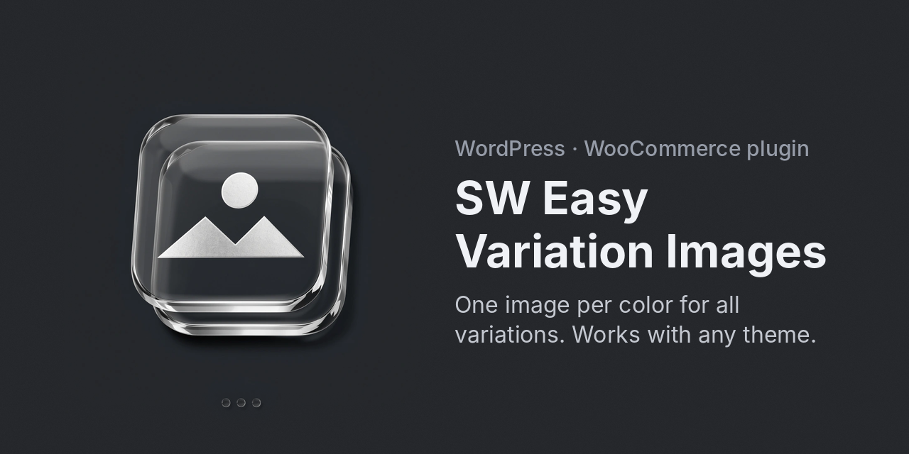

# SW Easy Variation Images

Imágenes de variaciones de WooCommerce sin trabajo repetitivo: eliges **una imagen por valor de atributo** (por ejemplo, por color) y todas las variaciones con ese valor la reciben. Funciona con cualquier tema y es compatible con **WoodMart**.

Un producto con 2 colores y 8 tallas tiene 16 variaciones. En WooCommerce cada una necesita su imagen por separado. Con este plugin eliges 2 imágenes y listo.

## Funciones

- **No toca nada por sí solo.** El plugin no cambia ningún producto hasta que pulsas un botón en el panel. Los productos donde no lo usas quedan exactamente como estaban.
- Panel **«Imágenes por atributo»** en la pestaña **Variaciones**: una fila por valor (Azul marino, Blanco…) con la imagen principal y las imágenes adicionales (galería) que tienen ahora sus variaciones, y su estado («todas iguales», «2 con otras imágenes»…).
- **Aplicar por fila**: el botón «Aplicar a 8 variaciones» cambia solo las variaciones de ese valor. Si alguna ya tiene otras imágenes, pregunta: sustituir en todas o solo en las vacías.
- **Deshacer** el último cambio.
- **Variaciones nuevas**: tras «Generar variaciones», las que no tienen imagen reciben las de su valor, solo en productos donde ya usaste el panel.
- **Galería de variaciones**: se detecta sola — WooCommerce 11.1+ (nativa, la que usa WoodMart 8.6+), plugin Additional Variation Images Gallery, o la galería antigua de WoodMart con WooCommerce anterior a 11.1. Con cualquier otro tema funciona la imagen principal estándar de WooCommerce.
- Inglés por defecto; español y ruso automáticos según el idioma de WordPress.

## Instalación

1. Descarga `sw-easy-variation-images.zip` de la última [Release](../../releases/latest).
2. WordPress → Plugins → Añadir nuevo → Subir plugin → Activar.
3. Abre un producto variable → pestaña **Variaciones** → panel **Imágenes por atributo**.

Requisitos: WordPress 6.0+, WooCommerce 7.0+, PHP 7.4+.

Las siguientes versiones llegan como actualización normal en **Plugins**.

## Uso

1. Elige el atributo en **Compartir imágenes por** (normalmente ya viene el color).
2. En la fila del valor pulsa **Elegir** y selecciona la imagen principal y, si aparece la columna, las imágenes adicionales.
3. Pulsa **Aplicar a N variaciones** en esa fila.

Las variaciones con «Cualquier …» en ese atributo no se modifican.

## Hooks

- `sw_evi_default_attribute` — atributo por defecto (`string $key, WC_Product $product, array $attributes`).
- `sw_evi_autofill` — devolver `false` para que las variaciones nuevas no reciban imágenes (`bool $enabled, int $product_id`).
- `sw_evi_gallery_provider` — dónde se guardan las imágenes adicionales: `woodmart`, `wvg`, `woocommerce` o `''` para desactivarlas.
- `sw_evi_woodmart_gallery` — forzar la detección de WoodMart (`bool $active`).
- `sw_evi_applied` — acción tras aplicar (`int $product_id, string $attribute, int[] $variation_ids`).

## Publicar una nueva versión

1. Sube `Version:` en la cabecera de `sw-easy-variation-images.php` y `SW_EVI_VERSION`.
2. Escribe las novedades en `RELEASE_NOTES.md`.
3. Haz push a `main`. GitHub Actions crea la etiqueta, la Release y el zip en ~1 minuto.

## Idiomas

Para añadir o cambiar textos: edita las traducciones en `tools/build_i18n.py` y ejecuta `python3 tools/build_i18n.py .` — regenera `languages/*.pot/.po/.mo` y avisa si falta alguna traducción.

## Licencia

GPL-2.0-or-later. Las actualizaciones usan [Plugin Update Checker](https://github.com/YahnisElsts/plugin-update-checker) (MIT).
